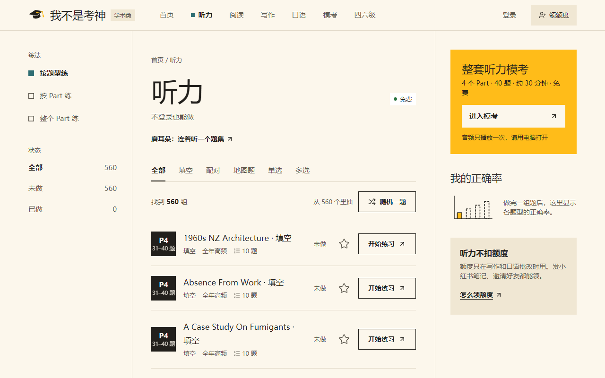
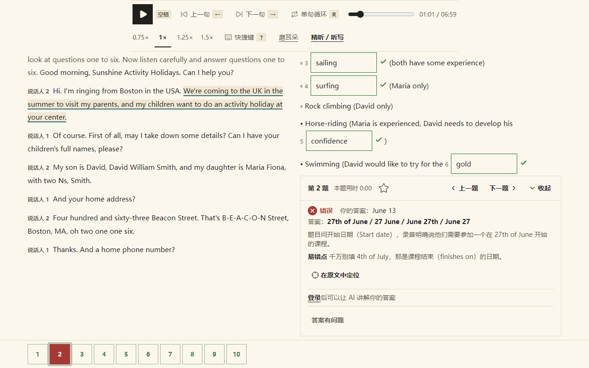
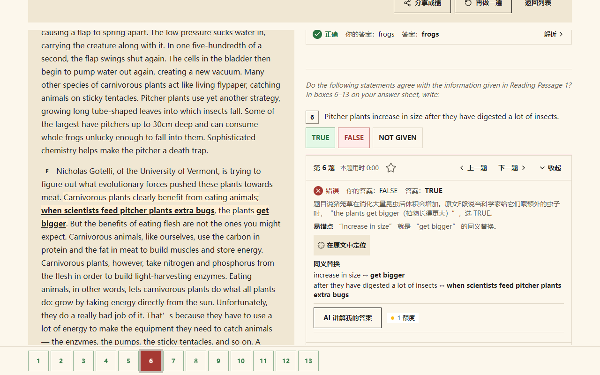
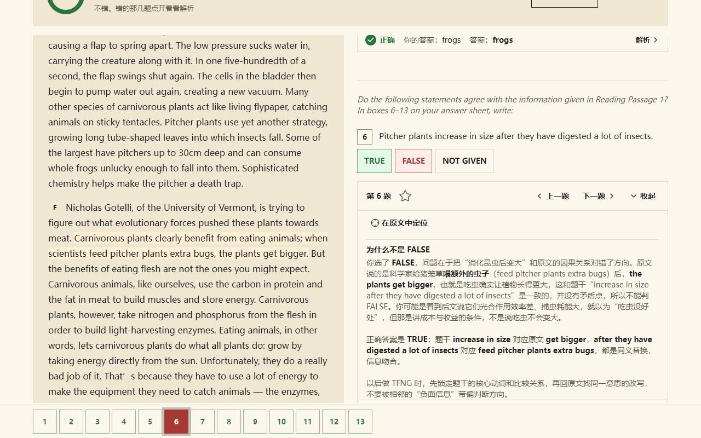
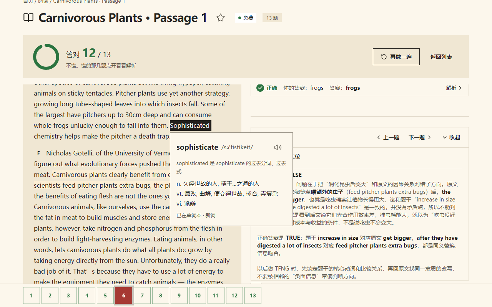
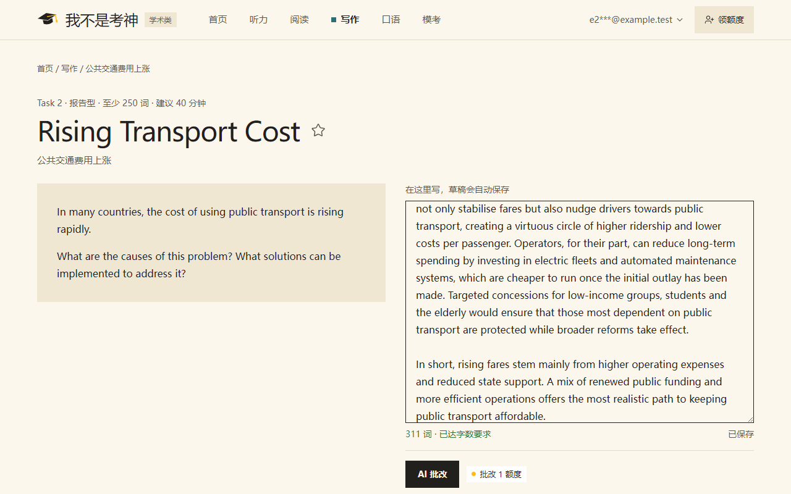
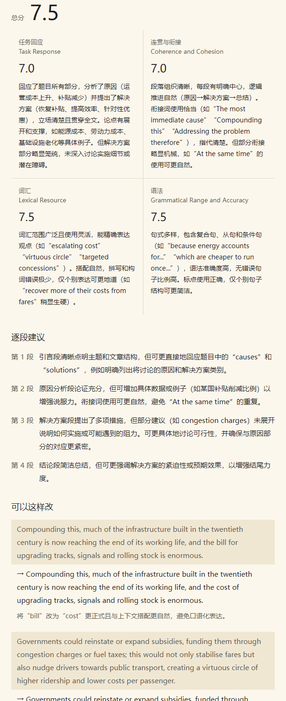
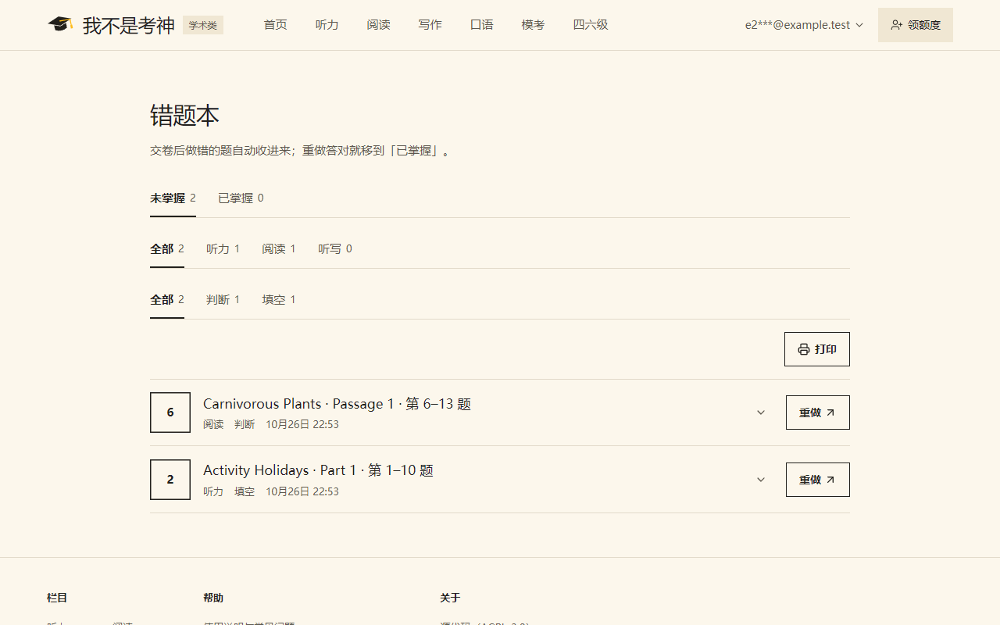
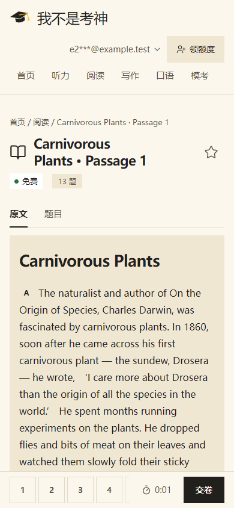

# 我不是考神

雅思学术类备考网站。听力、阅读、写作练习免费，不注册也能做；写作 AI 批改和错题 AI 讲解用额度，额度靠邀请好友.

线上地址：[wbsks.com](https://wbsks.com)



## 功能

**听力、阅读**

- 按题型、按 Part / 篇目、整个 Part / 整篇、整套四种练法，可按题型、题集、做没做过筛选
- 交卷出分，每题标对错，解析面板里有答案、解析和易错点
- "在原文中定位"：原文里高亮答案所在的句子
- 听力交卷后原文跟着音频走，点哪句从哪句播，可以单句循环；电脑上有快捷键（空格、← →、R）
- 做题时选中文字右键高亮，交卷前一直保留
- 手机上原文和题目分成两个标签切换

**写作**

- 题库按 Task 1 / Task 2 和图表类型、话题筛选，写作页显示词数，草稿自动保存
- AI 批改：总分、四项分和每项的理由、逐段建议、改写示例。分数按官方公开的评分标准给，Task 1 会核对你写的数据和图表是否一致
- 每次批改都留记录，能看到当时交的作文；同一篇没改过再交不扣额度，批改失败退回额度

**错题、单词**

- 交卷后错题自动进错题本，重做答对移到"已掌握"
- AI 讲解错题：针对你选的答案讲错在哪、原文依据、以后怎么避免。同一道题同一个答案讲过一次，再看不扣额度
- 双击英文单词查词（词典数据来自 ECDICT），可加入单词本，单词本记下原句和出处
- 背单词按间隔复习，每天新词数可以改

**账号**

- 不登录也能做题，记录存在本机；登录后交卷记录、作答进度、草稿、错题、收藏、单词本随账号同步
- 邮箱验证码登录，也可以设密码

口语目前只有题目，AI 口语模考和机考模考还在做。

## 截图

听力交卷后，原文跟随音频，当前句高亮：



阅读交卷后看解析，在原文中定位：



错题 AI 讲解：



双击查词：



写作页和 AI 批改结果：





错题本：



手机上做阅读：



## 技术栈

Next.js 16 + Payload CMS 3 单体应用，Postgres 17，pnpm。AI 走 OpenAI 兼容接口，后台填地址和 key。许可证 AGPL-3.0。

## 本机跑起来

```bash
docker run -d --name ielts-pg -e POSTGRES_USER=ielts -e POSTGRES_PASSWORD=<密码> -e POSTGRES_DB=ielts -p 5432:5432 postgres:17
docker run -d --name ielts-mail -e MP_SMTP_DISABLE_RDNS=true -p 1025:1025 -p 8025:8025 axllent/mailpit
cp .env.example .env   # DATABASE_URL 指向 ielts-pg；三个 SECRET 填 32 位以上随机串
pnpm install
pnpm dev               # http://localhost:3000，后台 /admin
```

第一次打开 `/admin` 时创建管理员；后台「邮件设置」主用 SMTP 填 `127.0.0.1:1025`（不加密、不用账号），验证码在 http://127.0.0.1:8025 查看。要用 AI 批改和讲解，在后台「AI 设置」填接口地址和 key。

仓库不带题库。题目从后台按 [题库导入格式](docs/import-format.md) 导入，`docs/import-example/` 里有示例；没导入题目时栏目页显示示例数据。详细说明见技术手册。

## 文档

- [使用说明](docs/user-manual.md)：给考生看的功能说明
- [技术手册](docs/tech-manual.md)：本机开发、代码结构、测试、后台运营
- [部署](docs/deploy.md)：生产部署（Docker）
- [题库导入格式](docs/import-format.md)
- [提交 PR 的要求](CONTRIBUTING.md)
- [报告](docs/reports/)：依赖漏洞修复等
