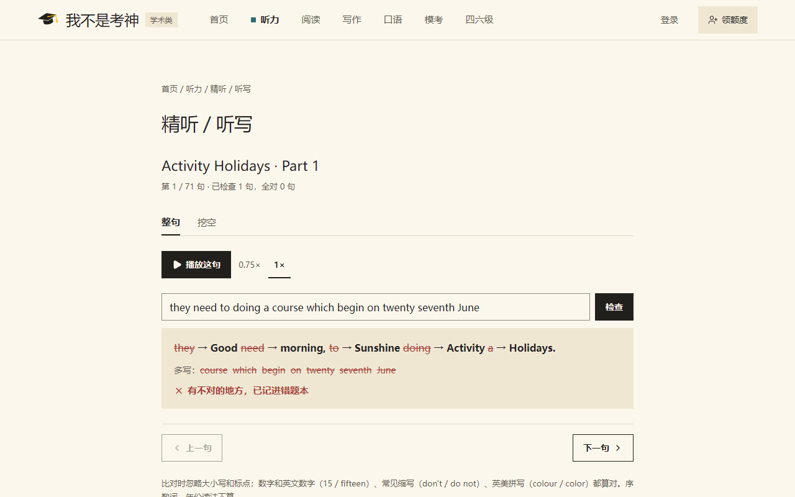
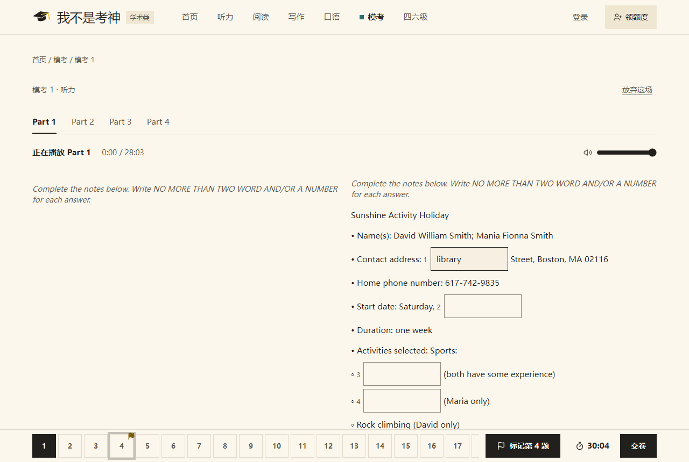
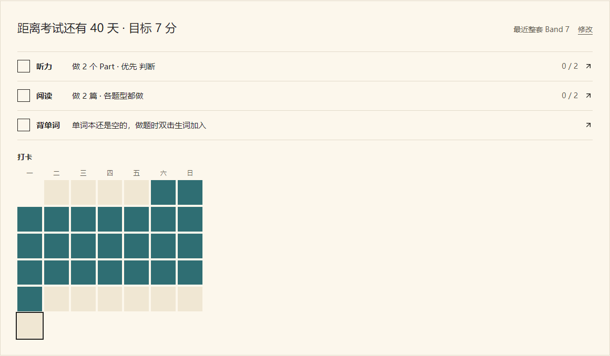
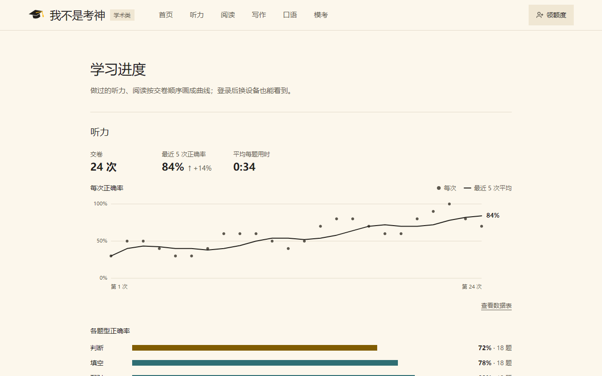

# 使用说明（考生）

> 网站上的 `/help`（页脚"使用说明与常见问题"）是本文的浓缩版，功能变了两边一起改。

这是一个雅思学术类（A 类）备考网站。题库浏览、听力、阅读、写作练习都**免费**，**不用注册**就能做。
写作 AI 批改、错题 AI 讲解（以后还有口语批改）会调用 AI，需要消耗额度，额度靠邀请好友和发小红书笔记获得，不花钱。

## 1. 找题

页头有五个栏目：**听力、阅读、写作、口语、模考**。

听力 / 阅读栏目有几种练法，在页面上方切换：

| 练法 | 适合 |
|---|---|
| 按题型练 | 专攻某一种题，比如判断题、填空题、配对题 |
| 按 Part 练 / 按篇目练 | 只练某个 Part（听力）或某一篇文章（阅读） |
| 整个 Part 练 / 整篇练 | 一次做完一整个 Part 或一整篇 |
| 整套练 | 整套 40 题 |

左侧可以按**题型、Part / 篇目、题集、状态（未做 / 已做）**筛选。做过的题会显示上次的成绩。

写作栏目按 Task 1 / Task 2 和题目分类（如图表类型、话题）筛选；草稿里写过字的题算"已做"。

**随机一题**：列表上方的"随机一题"在当前练法和筛选下随机打开一道（比如只抽阅读的判断题、只抽听力 Part 1、只抽 Task 2 利弊型）。状态选"全部"时优先抽没做过的，全都做过了就从全部里抽。随机进入的题交卷后（写作页一直）有"再抽一题"，按同样的条件接着抽，同一轮里不重复；"返回列表"回到原来的练法和筛选。

**机经**在 `/jijing`（首页文章区有入口），按题季（1–4 / 5–8 / 9–12 月）分组，可以按科目筛选。

## 2. 做题与交卷

1. 点"开始练习"进入练习页，直接在题目里作答。听力页顶部是音频播放器。
2. 作答会自动保存在这台设备上。关掉页面再打开，会提示"已恢复上次的作答"。
3. 底部是题号栏，点题号可以跳到那道题。做完点**交卷**，确认后显示得分。
4. 交卷后：
   - 每题标出对错，点题号或"看解析"打开解析面板，里面有正确答案和解析。
   - 点"在原文中定位"，原文里对应的段落或句子会高亮。
   - 听力会显示原文，原文跟着音频走，当前句高亮。点任意一句从这句开始播放。
     如果你手动滚动原文，自动跟随会暂停 5 秒。
   - 解析里有**同义替换**对照：题干怎么说 ↔ 原文怎么说；点"在原文中定位"时，原文里那个说法加粗下划线。交卷前不显示。
   - 结果条上有总用时、和建议时间的对比、用时最长的 3 题；解析里显示这道题用了多久。
   - 点"分享成绩"生成一张成绩图，可以保存或直接分享。登录时图上默认带你的邀请二维码，可以取消勾选。

**计时**：底栏右边是计时，点开可以选正计时、倒计时或隐藏，也能暂停。切到别的页面时不计时。

- 倒计时按阅读每题 1.5 分钟、听力按音频长度。到点只提示超时，计时变红显示超出多少，可以接着做，什么时候交卷自己定。
- 每道题的用时按你停在这道题上的时间累计，刷新页面接着算。

**高亮和查词**（电脑上用）：

- 选中文字右键"高亮"，在高亮上右键"清除高亮"。阅读文章、题目和选项、听力原文都能高亮，交卷后也还在，重做时清空。
- 双击英文单词弹出释义（变形词会显示原形），可以加入单词本。单词本记下原句和出处，点出处回到原文。

**听力快捷键**（电脑上用。练习页右上角"快捷键"按钮可以查看）：

| 按键 | 作用 |
|---|---|
| 空格 | 播放 / 暂停 |
| ← | 上一句。当前句已经播了 1.5 秒以上时，先回到这句开头 |
| → | 下一句 |
| R | 单句循环（交卷后可用） |
| ? | 打开快捷键说明 |

手机上可以正常练习。阅读和听力在窄屏上分成"原文 / 题目"两个标签切换。

## 3. 听力精听、听写、磨耳朵

**精听 / 听写**：听力交卷后，音频条上点"精听 / 听写"。

- 一句一句播放，听完把整句打出来，点"检查"。也可以切到"挖空"，只填空出的词。
- 比对时不管大小写和标点；数字和英文数字（15 / fifteen）、常见缩写（don't / do not）、英美拼写（colour / color）都算对。序数词（first / 1st）、年份读法还不算。
- 写错的句子进错题本的"听写"分组。
- 只有带逐句时间的练习能用，老套题没有。

**磨耳朵**：听力栏目页标题旁，或练习页音频条上点"磨耳朵"。

- 把当前题集按 Part 顺序一路连播，原文默认隐藏，题集播完就停。
- 手机锁屏后能在锁屏上暂停、上一句、下一句。

## 4. 全真模考

页头"模考"。只支持电脑，和真实机考一样。

- 列表第一行是**随机模考**：每次进入从题库里抽 4 个 Part 和 3 篇文章，优先抽没做过的。下面是固定卷。
- 开考前有说明页。听力 4 个 Part 连播，**只放一次**，只能调音量；音频放完有 2 分钟检查时间，到点自动交卷。
- 听力交卷后有过渡页，准备好了再开始阅读，阅读 60 分钟，到点自动交卷。
- 考试中不能查词，可以高亮；底栏"标记第 n 题"给没把握的题做记号。
- 刷新、关掉页面、断网都可以接着考，但时间按真实时间走，不会停。同一场只能在一个标签页里作答。"放弃这场"可以中途退出。
- 成绩单有听力、阅读两科 Band，两科平均（仅供参考），用时和各题型正确率，可以展开看解析。做错的题照常进错题本。

## 5. 写作

点写作题进入写作页，可以看到题目、配图和写作框。

- 写作框下方实时显示词数，并提示离字数要求还差多少。
- 草稿自动保存在这台设备上，登录后还会同步到账号。
- 写作没有对错，不进错题本，可以收藏。

**AI 批改**（要登录，每次 1 额度）

1. 写完点写作框下方的"AI 批改"，确认后开始。大约 30 秒出结果，可以先离开页面。
2. 结果有总分、四项分（Task 1 是任务完成，Task 2 是任务回应，另外三项是连贯与衔接、词汇、语法）和每项的理由，还有逐段建议和"可以这样改"的改写示例。
3. 字数要求：Task 1 至少 50 词、Task 2 至少 80 词才能批改，最多 1000 词。低于题目建议字数（150 / 250）也能批改，但会扣分并说明。
4. 批改失败会自动退回额度。同一篇作文没改过再点批改，直接显示上次的结果，不扣额度。
5. 写作页底部的"批改记录"列出这道题的历次批改；账号菜单里的"写作批改"能看到全部批改，每条都保存了当时交的作文。
6. 分数由 AI 按官方公开的评分标准给出，只供参考，和真实考试可能有出入。

有些 Task 1 题还不能批改（按钮是灰的），因为这道题的图表还没整理成文字。

## 6. 登录（可选）

不登录也能做所有练习。登录后可以换设备接着练。

1. 点页头"登录"，填邮箱，点"发送验证码"。
2. 邮箱里会收到一封带六位数字验证码的邮件，10 分钟内有效。**没收到先看垃圾邮件。**
3. 填入验证码即可登录。第一次登录会自动建账号，没有密码。
4. 好友邀请的：打开好友的邀请链接会直接到登录页，邀请码已填好；换了浏览器的话，点"有好友的邀请码？"手动填好友「我的额度」里的 8 位邀请码，注册后双方都得额度。

注意：

- 60 秒内只能发一次验证码，一个邮箱一天最多 10 封。
- 同一个验证码填错 5 次后作废，需要重新获取。
- 登录状态保持 30 天。

**登录后会同步的内容**：交卷记录、未交卷的作答进度、写作草稿、错题、收藏、高亮、单词本、备考计划。

- 第一次在某台设备上登录时，这台设备上未登录时做的记录会合并进账号，一条不丢。
- 两台设备改了同一份作答进度或同一篇写作草稿时，保留最后保存的那份。
- 断网时照常做题，联网后自动补传。
- **退出登录会清空这台设备上的记录**，账号里有完整备份，下次登录会拉回来。

## 7. 错题本与收藏

在页头账号菜单里打开（未登录也能用，数据存在本机）。

**错题本**

- 交卷后做错的题自动进入错题本，可以按栏目（听力 / 阅读）和题型筛选。
- 点"重做"会打开这道题所在的题组，重新作答。
- 重做答对后，这道题自动移出错题本，在"已掌握"里还能看到。
- 听写写错的句子在"听写"分组里，整句和挖空分开记。
- 点"打印"打印当前筛选下的错题（一次最多 100 道）：阅读带出处所在的段落，听力带出处那句和前后各一句；题目部分不带答案，答案和解析另起一页放在最后。打印窗口里可以另存为 PDF。

**AI 讲解**（要登录，每次 1 额度）

- 交卷后答错或没作答的题，解析面板里有"AI 讲解我的答案"；错题本里展开一道题也有。
- AI 会针对你的答案讲：错在哪、正确答案在原文哪里、以后怎么避免。
- 同一道题、同一个答案讲过一次，以后再看不扣额度。讲解失败会自动退回额度。

**收藏**

- 可以收藏单元（栏目页的单元行、练习页标题旁）、题目（交卷后的解析面板里）和写作题。
- "我的收藏"按收藏时间倒序排列，点一项直接开始练。
- 题目下架后，错题本和收藏里会显示"已下架"，可以移除。

## 8. 备考计划、背单词、学习进度

**今日任务**（首页）：

- 填考试日期和目标分，显示距离考试还有几天。
- 每天的听力、阅读题量按"还没做的题 ÷ 剩下的天数"排，先排你最弱的题型；还没做过题时各题型平均。
- 背单词一项是今天要复习的单词。
- 下面是最近 35 天的打卡日历。

**背单词**：账号菜单"背单词"。按间隔复习，记得越牢隔得越久；每天新词默认 20 个，可以改；凌晨 4 点算新的一天。可以选英音或美音。

**学习进度**：账号菜单"学习进度"。

- 听力、阅读各一块：交卷次数、最近 5 次正确率、每次正确率的曲线。
- 整套题做过 2 次以上，会画整套 Band 的曲线。
- 各题型正确率，最弱的题型有直接去练的链接。
- 听力、阅读栏目页标题下面也有同样一块，可以收起。

## 9. 添加到手机主屏幕

手机浏览器菜单里选"添加到主屏幕"（iPhone 在 Safari 分享菜单里），之后就能像应用一样从桌面打开。

## 10. 还在做的功能

- **口语**：看题已有；AI 口语批改需要额度。

栏目里标着"用额度"的按钮，在这些功能上线前不能使用。

## 11. 常见问题

| 问题 | 怎么办 |
|---|---|
| 页面提示"本机存储不可用" | 浏览器开了隐私模式或禁用了站点数据。题照常能做，只是记录不保存；登录后记录会存到账号里 |
| 验证码一直收不到 | 先查垃圾邮件；还是没有就过几分钟再试，或者换一个邮箱 |
| 在手机上打不开模考 | 模考只支持电脑，这是为了和真实机考一致 |
| 模考时不小心关了页面 | 重新打开那场模考接着考；时间没有停，按真实时间算 |
| 交卷后找不到"精听 / 听写" | 这套题没有逐句时间（老套题都没有），用不了精听 |
| 换了设备，记录不见了 | 在新设备上登录同一个邮箱 |
